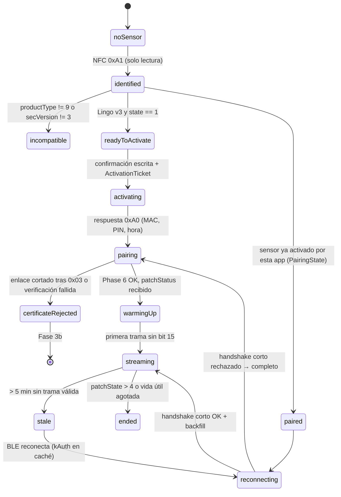
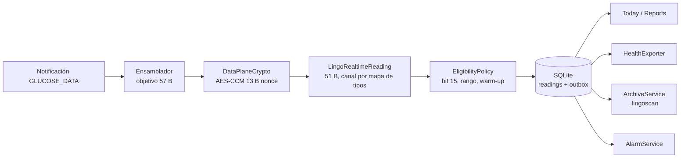

# Arquitectura de LingoScan

## 1. Estructura del repositorio

```
LingoScan_Claude/
├── LingoScan.xcodeproj
├── LingoScan/                      # target de app (iOS 26, SwiftUI)
│   ├── App/                        # LingoScanApp, AppEnvironment, rutas
│   ├── Features/
│   │   ├── Today/                  # valor actual, tendencia, curva 3/6/24 h
│   │   ├── Sensor/                 # estado, diagnóstico NFC, activación, pairing
│   │   ├── Diary/                  # comidas, ejercicio, notas
│   │   ├── Reports/                # TIR, promedio, CV, comidas, noche, semanal
│   │   ├── Data/                   # Health, exportar/importar, backup, recuperación
│   │   └── Settings/               # unidades, alarmas, permisos, apariencia, diagnósticos
│   ├── Services/                   # NFCService, SessionCoordinator, HealthExporter, ArchiveService, AlarmService, CredentialStore
│   ├── DesignSystem/               # tokens, GlassCard, MetricText, estilos
│   └── Resources/                  # Assets, Localizable.xcstrings (es, en)
├── LingoScanTests/                 # tests del target de app (simulador)
├── LingoScanReplacementProbe/      # app de prueba con otro bundle ID (T-15)
├── Packages/
│   ├── RoundWhiteDiscKit/          # fork local (MIT), base commit 7dd6396
│   └── LingoCore/                  # lógica pura, compila en macOS e iOS
│       ├── Sources/LingoCore/
│       │   ├── Domain/             # GlucoseReading, SensorSession, Event, Eligibility
│       │   ├── Store/              # SQLiteStore (actor), Schema, Migrations, Queries
│       │   ├── Archive/            # LingoScanArchive (export/import), Manifest, NDJSON, CSV
│       │   ├── Health/             # HealthSampleMapper (sin HealthKit; tipos puros)
│       │   ├── Reports/            # ReportsEngine
│       │   └── Diagnostics/        # Redactor, EventLog
│       └── Tests/LingoCoreTests/
├── Fixtures/                       # vectores públicos (plaintext Juggluco, CCM sintéticos)
└── docs/
```

`LingoCore` y el fork se prueban en el Mac con `swift test` (skill `swiftpm-macos`). Todo lo que toca CoreNFC, CoreBluetooth, HealthKit o UIKit vive en el target de app y se prueba en simulador o dispositivo.

## 2. Módulos y contratos

| Módulo | Responsabilidad | Tipo | Dueño |
|---|---|---|---|
| `SensorProfile` | Qué es el sensor leído por NFC: familia (`.libre3`, `.lingo`, `.unknown`), `productType`, `securityVersion`, serial (redactable), calentamiento, duración, firmware, `state` | struct Sendable (fork RWDK) | Opus |
| `CredentialStore` | Carga el JSON de identidad, valida, guarda en Keychain; devuelve `AppIdentity` + clave de firma por familia; rechaza listas vacías | actor | Sonnet |
| `NFCService` | Dos operaciones separadas y sin fallback entre sí: `readPatchInfo()` (`0xA1`) y `activate(receiverID:)` (`0xA0`). La segunda exige un `ActivationTicket` emitido por la UI tras confirmación | actor sobre `Libre3NFCActivationReader` | Opus |
| `SensorSessionCoordinator` | Máquina de estados de conexión; orquesta `SensorScanner`, `SensorSession`, `PairingFlow`, `DataPlaneCrypto`, ensamblador y decodificador; publica lecturas y estado | actor | Opus |
| `PairingState` | Lo que se persiste para reconectar: serial, MAC, PIN (`tail4`), Receiver ID, kAuth, etiqueta de identidad, `productType`, `securityVersion`, `CBPeripheral.identifier`, último `lifeCount` | Keychain (secretos) + SQLite (resto) | Opus |
| `ReadingRepository` | SQLite: lecturas, sesiones, eventos, revisiones, outbox de Health, registro de archivos | actor `SQLiteStore` (LingoCore) | Opus |
| `EligibilityPolicy` | Decide si una lectura es apta para Health y para la gráfica, con motivo | función pura (LingoCore) | Opus |
| `HealthExporter` | Autorización, outbox con reintentos, `HKQuantitySample` de glucosa y carbohidratos, lectura de entrenamientos | actor (app) | Sonnet |
| `ArchiveService` | Exporta e importa `.lingoscan`; carpeta elegida por el usuario; cadencia | actor (app) + LingoCore | Sonnet |
| `AlarmService` | Alarmas alta, baja y sin datos con `UNUserNotificationCenter` | actor (app) | Sonnet |
| `ReportsEngine` | Métricas sobre lecturas elegibles y eventos | struct pura (LingoCore) | Sonnet |
| View models | `@MainActor @Observable`, uno por feature, sin lógica de protocolo | app | Sonnet |

## 3. Máquina de estados del sensor



Cada transición se registra en `EventLog` (SQLite, redactado) con marca de tiempo y motivo. La UI muestra siempre el estado, la antigüedad de la última lectura válida y la calidad.

## 4. Flujo de datos de una lectura



Reglas:

- El parser elige el **primer canal cuyo tipo sea glucosa (1)** según el byte 34; no asume el canal 1. Guarda `capped`, `uncapped`, histórico, rate, trend, temperatura y banderas por separado.
- `EligibilityPolicy` devuelve `eligible(valueMgdl)` o `excluded(reason)` con razones enumeradas: `qualityFlag`, `outOfRange`, `warmUp`, `synthetic`, `duplicate`. Las excluidas se guardan con su motivo y nunca llegan a Health ni a la curva como glucosa.
- Vivo y backfill del mismo `lifeCount` se reconcilian por `recordID`; el primero en llegar manda salvo que el nuevo sea válido y el anterior excluido.

## 5. Concurrencia y segundo plano

- Actores para sesión, almacén, Health y archivo. `@MainActor` solo para view models y vistas. Modelos `Sendable`.
- `UIBackgroundModes: bluetooth-central`; `SensorScannerConfiguration.background(...)` con `restoreIdentifier` fijo; `restorationEvents()` al arrancar; `registerForConnectionEvents` para que iOS despierte la app cuando el sensor anuncia.
- `BGAppRefreshTask` para la exportación diaria (sin promesa de hora exacta) y `BGProcessingTask` opcional para compactar SQLite.
- HealthKit: escritura inmediata desde el outbox cuando la app está activa o despierta por BLE; reintentos con backoff si el dispositivo está bloqueado (`AfterFirstUnlock` no aplica a Health; se reintenta).
- Contador de secuencia saliente del plano de datos (`outCryptoSequence`) lo lleva `SensorSessionCoordinator`; se reinicia en cada Phase 6.

## 6. Persistencia de pairing y recuperación

| Dato | Dónde | Accesibilidad | Sincroniza a iCloud Keychain |
|---|---|---|---|
| Identidad Lingo (clave privada + certificado + clave de firma) | Keychain | `AfterFirstUnlockThisDeviceOnly` | No (se vuelve a cargar del JSON) |
| Receiver ID | Keychain + anotado por Juampa fuera del teléfono | `AfterFirstUnlock` | Sí |
| kAuth de la sesión activa | Keychain | `AfterFirstUnlockThisDeviceOnly` | No |
| PIN BLE, MAC, serial, identificador del periférico, último lifeCount | SQLite `sensor_sessions` | — | — |
| Export cifrado de recuperación | `LingoScan-lingoscan-<UTC>-<id>.lingoscan-recovery.json` en la carpeta del usuario, formato de `../LingoScan_Shared/RECUPERACION_V1.md` | PBKDF2-HMAC-SHA256 600 000 it. (CommonCrypto) + ChaCha20-Poly1305 (CryptoKit), AAD con `archive_id` y fecha | Lo mueve el usuario; lo abre también LingoScan_Astra |

Restaurar historial no garantiza recuperar el sensor activo: la ruta corta de reconexión necesita kAuth y PIN; si el handshake corto falla, se intenta el completo (reenvía certificado, no repite NFC). Esto se prueba en la Fase 3 con el sensor de sacrificio.

## 7. Entitlements y permisos

| Capability | Valor |
|---|---|
| Near Field Communication Tag Reading | `com.apple.developer.nfc.readersession.formats` = `TAG`; `com.apple.developer.nfc.readersession.iso15693.tag-identifiers` no requerido para NfcV genérico |
| HealthKit | `com.apple.developer.healthkit` + `healthkit.access` vacío; background delivery no necesario (escribimos) |
| Background Modes | `bluetooth-central`, `fetch`, `processing` |
| iCloud | iCloud Documents (contenedor `iCloud.com.otalvaro.lingoscan`) como fallback de la carpeta elegida |
| Keychain Sharing | grupo `SR8DQF26N7.com.otalvaro.lingoscan` (para la app de prueba T-15 solo lectura del Receiver ID) |
| Info.plist | `NFCReaderUsageDescription`, `NSBluetoothAlwaysUsageDescription`, `NSHealthShareUsageDescription`, `NSHealthUpdateUsageDescription`, `BGTaskSchedulerPermittedIdentifiers` |

## 8. Diagnóstico y logs

`EventLog` guarda eventos con hex redactado: se conservan los 2 primeros y 2 últimos bytes de cualquier blob mayor de 8 B, nunca claves, PIN ni kAuth, serial recortado a 3 caracteres. Un modo "diagnóstico privado" opcional (Ajustes) guarda tramas completas en `Logs/` fuera del backup habitual, con retención de 7 días, para la Fase 3b.
