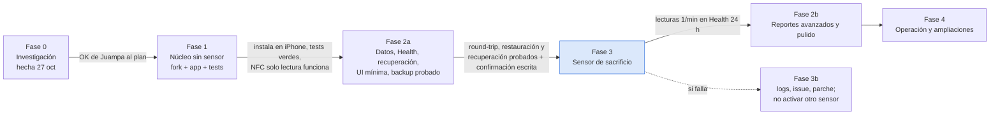

# LingoScan — Plan de desarrollo (Claude)

Fecha: 2026-10-27. Orquestador: Fable 5.1. Implementación: Opus (protocolo, cripto, BLE, persistencia) y Sonnet (UI, HealthKit, exportación, fixtures, docs). Juampa compara este plan con el de Astra en `../lingoScan_Astra/`.

## 1. Objetivo y alcance de la v1

Leer los biosensores Abbott Lingo propios (REF 78796-01, UDI-DI 00357599852009) en el iPhone 17 Pro Max (iOS 27.0.1) con una app SwiftUI propia, sin app ni cuenta de Abbott, con una lectura por minuto, cada lectura válida escrita en Apple Health, y todos los datos guardados en SQLite más un archivo abierto en iCloud Drive que sobrevive a un reemplazo de la app.

Alcance v1 decidido por Juampa: **núcleo + reportes en app**.

| Entra en v1 | Queda para después |
|---|---|
| NFC de solo lectura y activación con confirmación | Nightscout en servidor propio (Fase 4, opcional) |
| Pairing BLE Lingo, lecturas por minuto, backfill, reconexión en segundo plano | App y complicación de Apple Watch |
| SQLite + archivo portable (`.lingoscan`) + importación | Cetona y lactato (el protocolo los anuncia; Juggluco no los decodifica) |
| HealthKit: glucosa, carbohidratos; lectura de entrenamientos para superponer | Sincronización multi-dispositivo editable |
| Alarmas alta, baja y sin datos (umbrales que Juampa confirme; no médico) | mmol/L (solo presentación, fácil, pero no prioritario) |
| Reportes en app: tiempo en rango, promedio, SD/CV, respuesta a comidas, noche, semana a semana | Export a Health de notas libres (Health no tiene ese tipo) |
| Backup cifrado de credenciales de pairing | |

## 2. Premisas técnicas

- iOS 26.0 mínimo (Liquid Glass nativo, sin fallback), Swift 6.2, concurrencia estricta, SwiftUI puro, Swift Charts.
- Bundle ID `com.otalvaro.lingoscan`, team `SR8DQF26N7` (Apple Developer Program de pago). Nunca cambian.
- Dependencia única: fork local de RoundWhiteDiscKit (MIT, commit base `7dd6396`). Sin otras librerías de terceros.
- Credenciales Lingo: las publicadas en Juggluco 11.5.4 (`LingoCredentials.java`), uso personal autorizado por Juampa. Se cargan desde un JSON fuera del repo y viven en el Keychain.
- Lingo se identifica por `productType == 9` y `securityVersion == 3` en el patchInfo NFC. Cualquier otra combinación se reporta como no compatible y no se activa.
- Unidad: mg/dL entero en adquisición y almacenamiento. Las lecturas con bandera de calidad (bit 15) se guardan pero nunca se exportan ni se grafican como glucosa.

## 3. Fases y compuertas

Regla fija: ningún sensor se toca hasta que el código Lingo pase todos los tests de parser y cripto, la app esté instalada y el backup se haya restaurado una vez. La activación por NFC es la única acción irreversible y exige confirmación escrita de Juampa en el chat.

### Fase 1 — Núcleo sin sensor (tareas T-01 a T-08, T-11)

Objetivo: fork de RoundWhiteDiscKit con soporte Lingo probado con fixtures, proyecto Xcode LingoScan con `LingoCore`, pantalla principal y de sensor con datos sintéticos, diagnóstico NFC de solo lectura, instalación en el iPhone.

Orden de trabajo:

1. **T-01** Opus: clonar RoundWhiteDiscKit en `Packages/RoundWhiteDiscKit`, fijar commit, `swift build` y `swift test` verdes en el Mac. Comparar con la copia interna de xdripswift 7.2.0 y anotar divergencias.
2. **T-02** Opus: familia de sensor, selección de identidad por `productType`, clave de firma Lingo, rechazo de lista vacía, campos nuevos en `Libre3SensorState`, error explícito `certificateRejected`.
3. **T-03** Opus: plano de datos Lingo (ensamblador por longitud objetivo, trama de 51 B, `patchStatus` de 14 B, comandos `{1,2}`/`{1,3}`, historial y fast data) con los 12 vectores reales de Juggluco más sintéticos.
4. **T-04** Sonnet: vectores AES-CCM independientes (nonce 13/L=2 y nonce 7/L=8) generados con una implementación de referencia; tests positivos y negativos.
5. **T-05** Sonnet: cargador de credenciales JSON → Keychain, sin logs de secretos.
6. **T-06** Sonnet: proyecto Xcode, targets, entitlements, Info.plist, paquete `LingoCore`, build en simulador.
7. **T-07** Opus: dominio y almacén SQLite (`LingoCore`), `swift test` en Mac.
8. **T-08** Opus: `SensorSessionCoordinator` (máquina de estados, NFC solo lectura, activación con confirmación, pairing, plano de datos → almacén, reconexión, restauración en segundo plano, diagnóstico redactado).
9. **T-11** Sonnet: shell de la app, pantallas Hoy y Sensor con Liquid Glass y datos sintéticos.
10. **T-14** Fable: firma, instalación en el iPhone, permisos; diagnóstico NFC de solo lectura sobre un sensor (si responde dentro del aplicador; si no, se hará tras aplicarlo y antes de activar).

Criterios de salida: `swift test` de los dos paquetes verde; `xcodebuild test` del target de app verde en simulador; app instalada en el iPhone con permisos de Bluetooth, NFC y Health concedidos; estado `identified` mostrado con `productType`, `securityVersion`, calentamiento y duración leídos por NFC sin enviar `0xA0`.

### Fase 2a — Datos, HealthKit, recuperación y UI mínima (T-09, T-10, T-19, T-12a, T-13, T-15)

Puerta de validación del sensor (ajuste 4 de Astra): entra en 2a solo lo necesario para que la Fase 3 sea segura y no pierda datos; los reportes avanzados y el pulido esperan a tener lecturas reales.

1. **T-09** Sonnet: exportador HealthKit con cola durable y ledger append-only, matriz de elegibilidad, filtro estructural de sintéticos, identificadores de sincronización, carbohidratos; lectura de entrenamientos. Pruebas con sink inyectado; HealthKit del simulador en target aparte.
2. **T-10** Sonnet: paquete `.lingoscan` según el contrato compartido, carpeta elegida por el usuario en iCloud Drive, estados de iCloud, cadencia diaria y manual, importación con alias, linaje y conflictos.
3. **T-19** Fable + Opus: archivo de recuperación cifrado, registro durable de activación y modo "en pausa" para transferir el rol.
4. **T-12a** Sonnet: Diario, Datos, Ajustes y gráfica básica con tiempo en rango, media y SD.
5. **T-13** Sonnet: alarmas locales alta, baja y sin datos. Umbrales iniciales propuestos 70 y 180 mg/dL, 20 minutos sin datos; Juampa los confirma. Texto fijo: "no es un dispositivo médico".
6. **T-15** Fable + Sonnet: pruebas cruzadas con los paquetes de Astra y el verificador externo.

Criterios de salida: round-trip exportar→importar sin pérdida ni duplicados (tres importaciones seguidas y en ambos órdenes con los fixtures de `examples/merge/`); recuperación cifrada exportada e importada (R-01, R-04, R-05); muestras de glucosa visibles en Health del simulador desde el target aislado, sin duplicados tras reintentos; alarmas disparan en simulador.

### Fase 2b — Reportes avanzados y pulido (T-12b), después del primer sensor

Respuesta a comidas, noche, CV y comparación semanal, calibrados con lecturas reales; pulido de movimiento y Liquid Glass; rendimiento con 14 días de datos. No bloquea la Fase 3 ni la 4.

**Estado 27-oct (v0.2.0, build 2):** hecho el pulido de Hoy: curva con pellizco (1–24 h) y desplazamiento nativo, botón "Ahora", cursor por toque y pulsación larga, marcas agrupadas, color por trozos y pérdidas BLE ≤ 15 min unidas (D-24), rediseño tras auditoría (cabecera compacta, curva al 42 %, leyenda en botón "i", estadísticas en fila). "Sugerir rango" (T-22, D-25) a partir de las lecturas propias. Pendiente de T-12b: reportes (respuesta a comidas, noche, CV, comparación semanal) con 14 días de datos reales.

### Fase 3 — Primer sensor (de sacrificio) — CERRADA el 27-oct-2026

Sensor activado y autenticado a las 17:55 (a la tercera escritura NFC; las dos primeras fallaron antes de cambiar el estado del sensor). El sensor Lingo acepta el certificado de app de Juggluco. Pasos 1 a 7 hechos salvo las 24 h de observación, que pasan a Fase 4 (reconexión tras reinicio).

Protocolo, en este orden y con Fable registrando todo en `../NOTAS.md`:

1. Backup del estado actual (archivo `.lingoscan` y export cifrado de credenciales) restaurado una vez.
2. Diagnóstico NFC de solo lectura: confirmar `productType 9`, `securityVersion 3`, `state 1` (sin activar), calentamiento y duración. Anotar firmware; no anotar el serial completo.
3. Generar el Receiver ID (u32 aleatorio, guardado en Keychain con sincronización a iCloud Keychain y anotado por Juampa fuera del teléfono). No se usa el 1001 de Juggluco por defecto; queda como alternativa si el sensor devuelve `B1`.
4. Escaneo BLE pasivo: confirmar que el sensor (ya aplicado, aún sin activar, no anunciará nada; este paso solo valida que no hay otros Libre cerca).
5. Confirmación escrita de Juampa en el chat. Solo entonces: pantalla de activación → `0xA0` con Receiver ID y hora.
6. Pairing completo con el log de eventos activo (hex redactado). Resultado esperado: `0x04 CertificateAccepted`, Phase 6, suscripciones, `patchStatus`, primera trama de 57 B en calentamiento (bit 15), lecturas válidas a partir de los 60 minutos.
7. Primera lectura válida en SQLite y en Health. Dejar correr 24 horas con bloqueo, reinicio de app y de teléfono.

Si el sensor corta el enlace tras `SendCertificateLoadDone`, o RoundWhiteDiscKit lanza `sensorCertificateVerificationFailed` o `certificateRejected`: parar. Fase 3b.

### Fase 3b — Si Lingo no autoriza — NO NECESARIA

El sensor autorizó; se conserva solo como referencia. Queda como pulido entender el `patchInfo` de 64 B de los dos primeros intentos NFC.

1. Guardar el log completo del handshake (redactado) en `Logs/` (no versionado) y un resumen en `../NOTAS.md`.
2. Comparar byte a byte con el flujo de Juggluco (`docs/PROTOCOLO_LINGO.md` §5.3): orden de comandos de seguridad, tamaños (R1 23 B, challenge 40 B, respuesta 67 B), cabecera del certificado.
3. Comprobar con el log si el fallo es (a) el sensor rechaza el certificado de app, (b) la clave de firma Lingo no valida el certificado del sensor, (c) un timeout o un tamaño distinto. Cada caso tiene un parche distinto y acotado.
4. Redactar un issue para `airedev326/RoundWhiteDiscKit` con el log anonimizado. Juampa decide si lo publica.
5. Plan B: Android con NFC y Juggluco 11.5.4 exportando a Nightscout en el servidor de Juampa.

### Fase 4 — Operación y ampliaciones — ABIERTA

Primero: reconexión BLE tras reinicio de app y del teléfono, y backfill de huecos. Después Nightscout y Apple Watch.

- Sesión sostenida de 14 días: huecos medidos, backfill tras desconexiones, cambio de sensor con nuevo Receiver ID.
- Nightscout en el servidor de Juampa (Docker, MongoDB) como copia remota y fuente de reportes AGP; LingoScan sube `entries` por la API REST con `API_SECRET`. Opcional.
- Apple Watch (app y complicación) con el valor y la tendencia.
- Checklists de cambio de sensor, re-firma anual y reinstalación segura.

## 4. Riesgos y cómo se tratan

| Riesgo | Mitigación en el plan |
|---|---|
| El sensor rechaza el certificado de app (incógnita principal) | Fixtures y cripto validados antes; primer sensor de sacrificio; `certificateRejected` explícito; Fase 3b con plan B |
| El lote tiene otra `securityVersion` | Diagnóstico NFC de solo lectura antes de activar; variante desconocida = no compatible |
| Fragmentación BLE de los 57 B distinta de 15+20 | Ensamblador por longitud objetivo, agnóstico al tamaño de fragmento; tests con cortes en todos los límites |
| Fallos silenciosos del plano de datos (`try?` → `.raw`) | Contador y log de "raw inesperado"; estado `stale` visible en la UI |
| Pérdida de datos al reinstalar | SQLite + archivo abierto en carpeta del usuario + Health; prueba de reemplazo con otro bundle ID (T-15) |
| Pérdida del pairing al reinstalar | kAuth, PIN, MAC, Receiver ID en Keychain con `ThisDeviceOnly`; export cifrado de recuperación; Receiver ID anotado fuera del teléfono |
| Escribir basura en Health | Matriz de elegibilidad con motivo de exclusión; nunca valores con bit 15, fuera de 39..501, calentamiento ni sintéticos |
| Licencias | RWDK MIT; port de Juggluco (GPL-3) en fork personal sin distribución; si algún día se publica, el fork pasa a GPL-3 |
| Tokens y calidad | Tareas acotadas con archivos con dueño; Opus solo donde hay cripto, protocolo o concurrencia; Sonnet en el resto; Fable verifica con build y tests, no con lectura ciega |

## 5. Qué se entrega al final de la v1

- App LingoScan instalada en el iPhone, leyendo el Lingo cada minuto con reconexión en segundo plano.
- Apple Health con cada lectura válida (fuente LingoScan) y carbohidratos registrados.
- Carpeta en iCloud Drive con `LingoScan-<fecha>.lingoscan` diario, importable por esta app y por la app de prueba.
- Reportes en app: tiempo en rango, promedio, SD y CV, respuesta a comidas (pico, tiempo al pico, retorno), línea base nocturna, comparación semanal.
- Alarmas configurables con texto de no uso médico.
- `../NOTAS.md` con bundle ID, team, commits, Receiver IDs, procedimiento de backup y restauración probado, y lo aprendido sobre Lingo.
