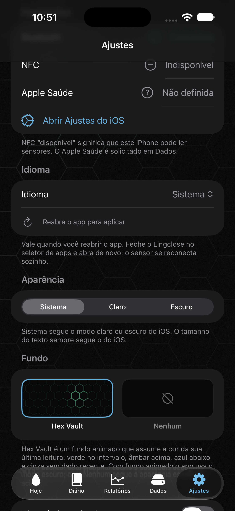

# T-29: selector de idioma dentro de la app

Brief del orquestador, 2026-10-31. Versión 0.4.2 (8). Decisión D-32.

## Objetivo

Elegir el idioma de Lingclose desde Ajustes, sin pasar por Ajustes de iOS: Sistema, Español, English o
Português (Brasil). La app ya estaba localizada en es, en y pt-BR (T-26).

## Diseño

- `LanguagePreference` (`Features/Settings/Language/`): enum con `system`, `spanish` (`es`), `english` (`en`) y
  `portugueseBrazil` (`pt-BR`). `apply(defaults:)` escribe `AppleLanguages = [código]` en el dominio de la app y la
  marca propia `app.language.override`; con `.system` borra ambas. `current(defaults:)` devuelve un idioma solo si
  `AppleLanguages` empieza por su código **y** existe la marca, para no confundir lo que pone iOS (dominio global o
  idioma por app de Ajustes de iOS) con una elección hecha en Lingclose.
- Los idiomas se muestran con su endónimo ("Español", "English", "Português (Brasil)"); "Sistema" va localizado.
- `LanguageSection`: Picker en Ajustes, antes de Apariencia. Si la selección difiere de la que había al abrir la
  pantalla, muestra "Pendiente de reabrir la app".
- Además se pasaron a claves (`llm.catalog.*`, `rangeSuggestion.parse.*`) los textos de `LLMCatalog` y
  `RangeSuggestionReplyParser` que usaban la frase española como clave y no estaban en el catálogo.

## Limitación: hay que reabrir la app

`String(localized:)` resuelve el idioma con `Bundle.main` al arrancar el proceso, y iOS lee `AppleLanguages` en ese
momento. El cambio se aplica al cerrar Lingclose desde el selector de apps y abrirla de nuevo; el sensor se reconecta
solo. No se recarga en caliente (`.environment(\.locale)` no cambia `String(localized:)`; cambiar el `Bundle` con
swizzling es frágil) y la app nunca se cierra a sí misma (`exit()` está descartado).

## Verificación

- `LanguagePreferenceTests` (Swift Testing, `UserDefaults(suiteName:)` temporal): sistema por defecto, cada idioma
  escribe código y marca, `.system` borra ambos, `AppleLanguages` sin marca cuenta como sistema, ida y vuelta.
- Simulador (iPhone 17 Pro Max, idioma en-US, datos de preview): Português → reabrir → pestañas Hoje, Diário,
  Relatórios, Dados, Ajustes; Sistema → reabrir → inglés.

